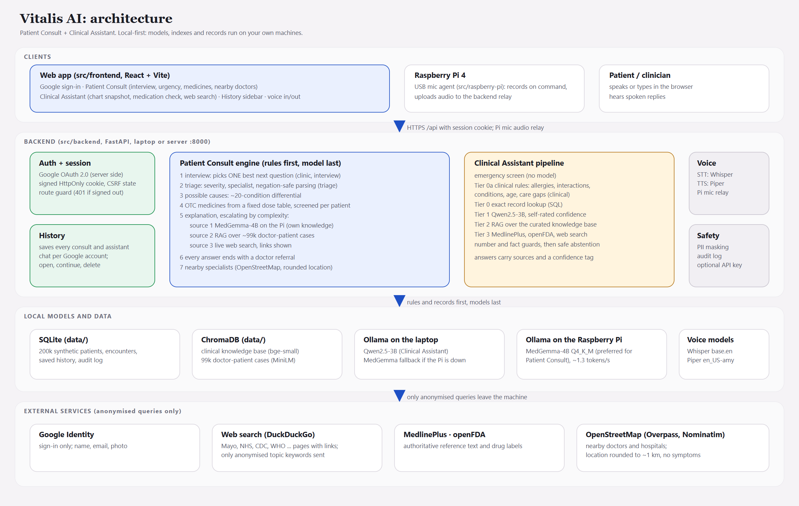

# Architecture and design decisions



The diagram above is the system at a glance (`architecture.png`). Demo script: [demo-flow.md](demo-flow.md). Evidence: [test-evidence/](test-evidence/). Security: [../SECURITY.md](../SECURITY.md). Licences: [../LICENSES.md](../LICENSES.md).

## 1. Components (all free / open source)

| Layer | Choice | Licence | Why |
|---|---|---|---|
| API | FastAPI + Uvicorn | MIT / BSD | Async, typed, auto OpenAPI docs at `/docs` |
| UI | React + Vite | MIT | Fast dev loop, small bundle (~50 KB gzip) |
| LLM runtime | Ollama | MIT | One-line local serving, keeps the model resident (`keep_alive`), JSON-constrained output |
| LLM | **Qwen2.5-3B-Instruct** (default), Qwen2.5-7B / Llama-3.1-8B (GPU option) | Apache-2.0 / Llama | See §2 |
| STT | faster-whisper (CTranslate2, int8) `base.en` / `small.en` | MIT | ~4× faster than reference Whisper on CPU, same accuracy; built-in VAD |
| TTS | Piper (neural, ONNX) → pyttsx3 → browser voice | MIT | Piper is real-time on CPU/Pi; the voice already exists in this repo |
| Embeddings | BAAI/bge-small-en-v1.5 via fastembed (ONNX) | MIT | 384-dim, 130 MB, strong retrieval for its size, no PyTorch needed |
| Vector DB | ChromaDB (embedded, HNSW, cosine) | Apache-2.0 | Zero-ops, persistent, sub-10 ms queries |
| Records DB | SQLite (WAL) + FTS5 | Public domain | 200k patients + 349k encounters in one file; name search in ms |
| Online fallback | MedlinePlus (NIH), openFDA, Wikipedia | Free, no key | Authoritative first, general last |

## 2. Model selection: priorities were accuracy, latency, fast inference

Requirements for the *primary* model: reliable instruction following and **valid JSON output** (the pipeline reads a
confidence score), strong factual recall, low latency on a CPU laptop, free licence.

| Candidate | Verdict |
|---|---|
| **Qwen2.5-3B-Instruct** | **Default.** Widely reported as strong at instruction following and structured/JSON output for its size, ~2 GB at Q4, small enough for CPU-only laptops. Because answers are *grounded* by RAG, a small model suffices. |
| Qwen2.5-7B-Instruct / Llama-3.1-8B (`llama3:latest` is already installed here) | Recommended when a GPU (≥8 GB) is available: better recall for Tier 1, but several times slower on CPU. Switch with one env var (`HVA_LLM_MODEL`). |
| Phi-3.5-mini / Llama-3.2-3B | Viable alternatives at the same size; not benchmarked here. |
| Medical fine-tunes (Meditron, BioMistral, OpenBioLLM) | Rejected as the default: older bases, weaker instruction/JSON following, 7B+ so slower, and no evidence they beat a grounded general model on *retrieval-grounded* tasks. Worth benchmarking with `scripts/evaluate.py` if licences and hardware allow. |

Design principle: **don't make the small model the source of truth.** Facts come from the EHR (Tier 0) and the
curated corpus (Tier 2); the LLM phrases and checks them.

## 3. Answer pipeline

```
question ─► emergency screen ──(red flag)──► fixed emergency message + banner (no LLM)
   │
   ├─ patient selected & asks for a record fact ─► Tier 0  SQL lookup  (exact, ~0 ms)
   │
   ├─ retrieval (~10 ms) + entity gates decide the route:
   │     · dosing question & matching reference ─► quote the reference dose VERBATIM (no LLM)
   │     · specialised term found nowhere in the KB ─► skip Tier 1 (the model would improvise)
   │     · strong, on-topic KB match ─► skip Tier 1 (curated source beats model memory; saves a call)
   ▼
 Tier 1  LLM answers as JSON {answer, confidence, needs_reference}
         accepted only if confidence ≥ 0.85, needs_reference=false, English, and every number it states
         is present in the question/record
   │ (else)
   ▼
 Tier 2  top passages that pass the gates → LLM answers *only* from them → accepted only if supported=true
         and every number in the answer appears in the passages (else the passage is quoted verbatim)
   │ (else)                                     [patient-specific questions stop here: never sent to the web]
   ▼
 Tier 3  anonymised topic query → MedlinePlus (phrase + plain) ‖ openFDA
         → same gates → grounded LLM (same numeric check) → accepted only if supported=true
   │ (else)
   ▼
 Abstain: "could not find a reliable answer – consult a clinician"
```

Passage gates (`app/grounding.py`): every *rare* term in the question (a word that is not a whole word in the embedding
model's vocabulary: drug and disease names, acronyms) must appear in the passage, and the passage must be **about** that
term (in its title or section label), not mention it in passing.

Departures from the literal "LLM first" brief, each driven by a failure found while testing, and why:

1. **Tier 0 (EHR lookup) comes before the LLM.** A patient's HbA1c lives in a database; asking a model to recall it can
   only lower accuracy. Lookups are deterministic and instantaneous.
2. **Doses are quoted, never paraphrased.** A 3B model once reported an elderly *starting* dose as "the usual adult dose".
3. **The curated KB outranks model memory when it has a strong match.** The 3B model answered red-flag lists and
   thresholds confidently from memory and was wrong (malaria red flags, fever = 37.5 °C). This is also faster: one LLM
   call instead of two. `HVA_STRICT_LLM_FIRST=true` restores literal LLM-first behaviour.
4. **Unverifiable specialised terms never reach Tier 1.** The model invented symptoms and treatment for a made-up
   syndrome at ≥ 0.85 self-rated confidence. Such questions go to the online sources, which verify them or lead to abstention.
5. **Numbers must come from sources.** The model wrote "at least 2 hours" inside a grounded answer whose source said 4.
6. **"About", not "mentions".** "What is gout?" was answered from the furosemide side-effect list.
7. **Abstention is a first-class outcome.** For healthcare, "I don't know" is better than a plausible guess.

## 4. Latency budget (CPU laptop, 3B model)

Measured on the development machine (Intel Core Ultra 9 185H, 16 cores, **no GPU**, Qwen2.5-3B at ~19 tokens/s
generation, ~700 tokens/s prompt processing). Your hardware will differ; re-run `scripts/evaluate.py`.

| Path | Measured | Notes |
|---|---|---|
| Emergency, EHR lookup (Tier 0), verbatim reference dose | **< 1 s** end to end (≈ 0.6–1.0 s including Piper speech) | no LLM involved |
| KB answer needing the LLM (Tier 2) | **≈ 4–8 s** (p50 ≈ 4 s, p95 ≈ 6–7 s over the evaluation set) | one grounded call, ≤ 200 new tokens |
| Online-fallback answer (Tier 3) | **≈ 7–13 s** | web fetch ≈ 0.7–1.5 s, plus a grounded LLM call, plus a skipped/rejected Tier 1 in some cases |
| Retrieval | 10–20 ms (first call after start-up ≈ 0.6 s) | embedded HNSW, cached query embeddings |
| STT | transcribed 3/3 TTS-generated questions exactly | faster-whisper `base.en`, int8, VAD |

CPU generation speed is the bottleneck. In order of impact, the levers are: a GPU (or Apple silicon) with the 7B model
instead of CPU with the 3B; streaming tokens to the UI (not yet implemented, so the whole answer appears at once); a
smaller model for the grounded step (e.g. `qwen2.5:1.5b-instruct`, untested here for accuracy).

Already applied: Ollama availability probe is cached (an offline LLM adds no per-request timeout); models warm up at
startup; sentence-level chunks and trimmed passages keep prompts short; answers are length-capped; the LLM is skipped
entirely whenever a deterministic path (Tier 0, verbatim dose, strong KB match → one call) can answer.

## 5. Voice

- **Laptop (now):** the browser captures the mic (`MediaRecorder`) and posts WebM/Opus to `/api/stt`.
- **Pi (later):** `src/raspberry-pi/pi_client.py` captures from the external mic (selected by `HVA_MIC_DEVICE`),
  posts WAV to `/api/voice/chat`, plays back the reply. Server code is identical for both.
- STT is biased with a clinical vocabulary prompt to cut drug-name errors.

## 6. Clinical safeguards

| Risk | Control |
|---|---|
| Missed emergency | Regex red-flag screen on every message; informational questions ("what are stroke signs?") don't trigger it |
| Hallucinated facts | Confidence gating, grounding-only prompts, rare-entity + "about" passage gates, unverifiable-term guard, numeric grounding, English/placeholder output checks, abstention |
| Hallucinated note content | The note is built from the conversation only (the chart is never given to the model); medicines/allergies and rare terms not in the transcript are flagged; an assessment containing terms the clinician never said is replaced by the clinician's own words |
| Unsafe dosing | Doses are quoted verbatim from the reference, never paraphrased by a model |
| Autonomous charting | Notes are **drafts**; a clinician edits and explicitly approves; triage is labelled "rule-based, clinician must confirm" |
| PHI leaving the system | Only anonymised keywords are sent to online sources (IDs, phones, emails, dates and the patient's name are stripped); fully local otherwise |
| Accountability | Append-only `audit_log` (PII-masked); every response shows tier, confidence and sources |
| Access | Optional `X-API-Key`, CORS allow-list; for production add SSO/OIDC, TLS, role-based access |

## 7. Measuring the ≥85 % target

`scripts/evaluate.py` generates cases from the knowledge base and patient DB and reports accuracy per category:

| Category | Pass criterion |
|---|---|
| kb_conditions | ≥ 2 of 3 expected key terms in the answer |
| kb_drugs | all key numbers of the reference dose present |
| patient | exact value present |
| paraphrase | hand-written, differently worded questions; ≥ 1 expected fact present |
| unknown (fictional drugs/diseases) | **must decline** |
| `--heldout`: heldout_kb / heldout_web / heldout_decline | unseen paraphrases, legitimate questions needing the online tier, fictional entities and patient questions with no data |

### Results (Qwen2.5-3B-Instruct, online fallback on, final code)

| Run | Cases | Correct | Accuracy |
|---|---|---|---|
| Regression suite (templated + hand paraphrases) | 132 | 130 | **98.5 %** |
| Held-out set, **first run before any fix** | 22 | 19 | **86.4 %** |
| Held-out set after fixes (no longer independent) | 22 | 20 | 90.9 % |

How to read these honestly:

- The regression suite was used while developing the gates, so it overstates generalisation; it is a regression test.
  The first held-out run (86.4 %, n = 22) is the better estimate, and with 22 cases its 95 % interval is roughly ±15 points.
  The ≥ 85 % target is met on this evidence **but not demonstrated with statistical confidence**.
- 60 of the 132 regression cases are exact record lookups (Tier 0, deterministic) and 8 test abstention; accuracy on
  *generated knowledge answers alone* is the more relevant figure (kb + paraphrase: 62 cases, ≈ 97 %).
- Remaining misses are safe abstentions ("could not find a reliable answer") or incomplete-but-not-wrong answers, not
  confident wrong answers. Strict safety rules (numeric grounding, rare-entity gates) deliberately trade some recall for
  precision.
- Every test pass above was preceded by a real defect found by running the system: see the "Departures" list in §3.

Caveats you should keep in mind:

- The auto-generated cases are *derived from the same corpus*, so they measure retrieval-and-grounding fidelity, not
  medical truth, and they will read optimistically. They are a regression test and a floor, not a clinical validation.
- For a defensible figure, have clinicians write 200+ blind questions (paraphrased, typo-ridden, multi-part) and
  grade the answers; add them as cases to `HELDOUT` / `build_cases()`.
- Accuracy depends on corpus coverage. The bundled KB is ~30 conditions, 16 drugs and a few reference tables; questions
  outside it resolve via MedlinePlus/openFDA or abstention. Load your approved documents to raise coverage.
- The online tier was measured while MedlinePlus and openFDA were reachable.

## 8. Scaling the 200k-record dataset

SQLite handles 200k patients comfortably (single-digit-ms lookups). Exact facts are read by SQL, so those records need
no embedding. Optional semantic patient search: `build_index.py --patients N` embeds N record summaries (CPU embedding
runs at several hundred docs/s). For multi-user production, move records to PostgreSQL and the vectors to Qdrant or
pgvector; the service boundaries (`patients.py`, `vectorstore.py`) are the only code that changes.

## 9. Limitations (read before real-world use)

- Prototype on **synthetic data**; the seed knowledge base is small and general. Not clinically validated, not a medical
  device, no regulatory (FDA/CE/CDSCO/HIPAA/GDPR) assessment.
- Self-reported LLM confidence from a 3B model is a weak signal (it confidently stated wrong numbers and invented a
  syndrome during testing); the deterministic gates, not the model, carry the safety load.
- The "rare term" test uses the embedding model's vocabulary as a proxy for "specialised word"; unusual spellings of
  real drugs are treated as unknown and abstain (safe, but a recall loss).
- No token streaming yet: LLM-backed answers appear all at once after 4–13 s on CPU.
- Emergency detection is keyword-based: it will miss unusual phrasing. It supplements, never replaces, clinical judgment.
- Whisper `base.en` is English-only; use `small` / `medium` (multilingual) for other languages at higher latency.
- Patient Consult sessions are held in memory (lost on restart); saved history is in SQLite. Move sessions to Redis/SQL for multi-instance deployments.
